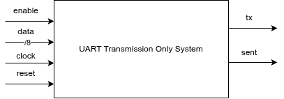
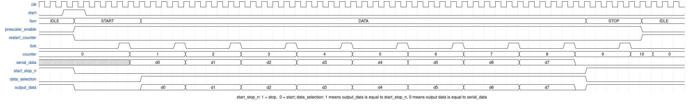

# Stage 1: Implementation

This document describes the design of [Stage 1](../README.md#stage-1-sending-one-byte-per-second) (sending one byte per second).

## Black Box

The first step is to define what the system needs as a black box. Since in this stage we only need to send a single byte, the system was designed with the following inputs and outputs:

| Direction | Signals                                 |
| --------- | --------------------------------------- |
| Inputs    | `clock`, `reset`, `enable`, `data`      |
| Outputs   | `tx`, `sent`                            |

The idea is simple: the byte to be sent is placed on `data`, and a pulse on `enable` starts the transmission. The system then sends the data serially through `tx` and, once it finishes (that is, after sending the stop bit), it emits a pulse on `sent`. This system is meant to be driven by an external one, which tells it when to start a transmission and waits for the end-of-transmission signal before sending the next byte. The following diagram illustrates this system:

## Subsystems

The design requires the following subsystems:

1. **State machine:** handles the different states of the transmission.
2. **Counter:** keeps track of how many bits have been sent.
3. **Prescaler:** controls the rate at which the data is sent.
4. **Multiplexer:** selects what goes to the output, either the data bits or the control bits (start and stop).

## Timing Diagram

The following timing diagram shows the expected behavior of the signals:

